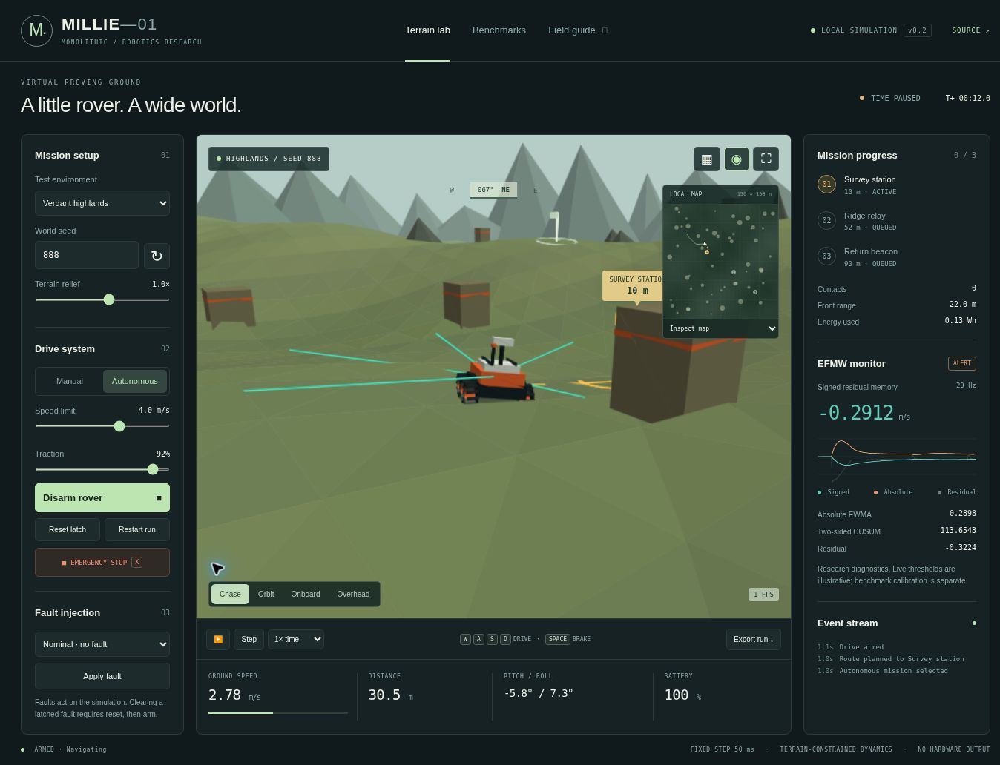

# Millie-01 — simulation-first robot body for Millicent

**Monolithic LLC / Matthew Chenoweth Wright · 2026-11-16 · Terrain lab v0.2.0 / Python prototype v0.1.0**

## New: interactive 3D terrain lab



The root [`index.html`](index.html) is a complete static GitHub Pages entry point. It uses local modules and styles in `assets/`; no build, package install, CDN, API key, or backend is required. WebGL renders the 3D world on supported browsers; a lower-resolution software 3D renderer handles browsers without WebGL.

- Seeded hilly landscapes, ridge terrain, boulder slalom, and a flat calibration field.
- Six-wheel rover with terrain following, manual keyboard/touch driving, traction, acceleration, collision boundaries, and simulated front/rear/side sensing.
- A* autonomous multi-goal missions, editable obstacles and goals, chase/orbit/onboard/overhead cameras, grid and sensor overlays.
- Arm/disarm, latched emergency stop, fault injection, pause, step, time scaling, and restart.
- Repository-aligned signed residual memory, absolute EWMA, and two-sided CUSUM with live charts and event logs.
- Browser-computed detector benchmarks (100 calibration + up to 500 evaluation runs) and an 18-mission navigation matrix; raw JSON and summary CSV downloads.

**Enable Pages manually:** in this repository's Settings → Pages, choose **Deploy from a branch**, branch **main**, folder **/ (root)**, then Save. The entry point and `.nojekyll` are included. This change does not enable Pages or add a deployment workflow.

For local use, run `python -m http.server 8000` at the repository root and open `http://localhost:8000/`. Browser modules need HTTP(S); do not launch the HTML through `file://`.

Choose **Autonomous → Arm rover** for a survey mission, or **Arm rover → W/A/S/D** to drive. Arrows also drive; Space brakes; X latches E-stop; P pauses; C cycles cameras; R restarts. Reset a fault latch and arm in separate actions. See the in-app Field guide and [model, benchmark protocol, and limitations](docs/WEB_LAB.md).

```bash
node --test tests/web_sim.test.mjs
node benchmarks/run_web.mjs /tmp/millie01-web-benchmark.json
```

The outdoor browser model is a separate virtual research envelope, not the indoor physical robot specification. It is a terrain-constrained kinematic simulation, not a rigid-body dynamics engine or physical validation. [Recorded browser-lab verification](docs/WEB_LAB_TEST_REPORT.md) includes negative benchmark results.

**Status: SOFTWARE PROTOTYPE / HARDWARE SPECIFICATION. No physical robot was assembled, wired, energized, or validated.** This repository provides an executable offline rover simulation, fail-stop software safety supervisor, comparative residual monitors, test suite, physical reference architecture, provisional BOM, and phased construction plan. It does **not** certify physical safety, demonstrate a new physics law, or turn a conversational AI into a conscious or continuously self-improving being.

## Why a low-speed rover first?

A small differential-drive indoor research platform is a tractable embodiment test: no humanoid balancing, no grasping tools, no open-ended autonomy. It gives perception, physical control, human authorization, logs, failure handling, and clear research questions. Later manipulator modules require their own hazards and validation.

## Software quick start (Python 3.10+, standard library)

```bash
python -m unittest discover -s tests -v
python -m millie01 demo --scenario clear --steps 80 --out /tmp/millie01-clear.json
python -m millie01 demo --scenario estop --steps 80 --out /tmp/millie01-estop.json
python -m millie01 matrix --steps 80 --out /tmp/millie01-matrix.json
```

Optional installation: `python -m pip install -e .`; console entrypoint `millie-01`.

**Original Python browser replay:** run `python -m http.server 8000` from the repository root and open `http://localhost:8000/replay.html` to inspect the bundled or uploaded Python traces. The original replay is preserved separately from the new interactive terrain lab.

**No simulation command can command physical motors.** The code has no GPIO/serial motor driver connector. The hardware firmware is a deliberately non-actuating bench skeleton; physical actuation remains a separate gated engineering task.

## Safety architecture, not an AI promise

```text
Human local consent / STOP button
         │
         ▼
User interface (future) ── authenticated, expiring velocity request
         │
         ▼
Python safety supervisor ── hard sensor limits and bounded commands
         │                         │
         │                         └── zero-motion / latched fault
         ▼
Bench-only Pico 2 interface (LIVE PWM DISABLED IN v0.1.0)
         │
         ▼
Motor driver STBY low by default ── 2 × low-power motors (FUTURE)
         ▲
         │
6 V motor supply ── fuse ── physical NC E-STOP / suitable disconnect ── VMOT
                              ▲ independent of OS, Wi-Fi, AI, and GPIO

Sensor inputs -> safety supervisor
             -> telemetry -> signed EWMA ('EFMW-style'), absolute EWMA, CUSUM
                              (research-only, never authorizes motion)
```

The physical E-stop must interrupt the **motor supply** through an appropriately rated, verified, independent circuit. Disabling an MCU pin or sending a software STOP is not a substitute. Recovery requires human inspection plus separate reset and arm actions. The device must remain confined to a supervised indoor test area.

## What "EFMW-aligned" means here

- Preserve signed evidence of prediction-vs-measurement error in a named memory state.
- Emit an auditable, timestamped trail of predictions, measurements, and fault decisions.
- Track uncertainty and explicitly deny unsupported/expired commands.
- Test signed EWMA side-by-side with **standard** absolute EWMA and two-sided CUSUM.
- Keep proposed recursive/coherence explanations separate from verified mechanical safety.

**Crucial scientific boundary:** `C_t = |0.97 M_(t-1) + 0.03 r_t|` is an ordinary signed EWMA detector. There is no proven EFMW-specific detection advantage. In v0.1.0, detector thresholds are *illustrative*, not statistically calibrated, and alerts are telemetry advisories rather than motor safety permissions.

## Repo map

| Path | Purpose |
|---|---|
| `millie01/` | Offline controller, state machine, physics-lite rover, diagnostic monitors, CLI |
| `index.html`, `assets/` | Interactive 3D browser lab and shared deterministic JavaScript simulation |
| `replay.html` | Original Python JSON trace replay |
| `benchmarks/run_web.mjs` | Reproduce the complete browser benchmark in Node |
| `docs/WEB_LAB.md` | Browser model, controls, mathematical definitions, benchmark protocol |
| `docs/WEB_LAB_TEST_REPORT.md` | Browser-lab verification and measured limitations |
| `tests/` | Unit and scenario safety tests; not physical safety certification |
| `docs/TEST_REPORT.md` | Local test results, scenario matrix, and unresolved hardware obligations |
| `hardware/ARCHITECTURE.md` | Sensor/controller/motor power partition; wiring boundaries |
| `hardware/BOM.csv` | Provisional parts, budget ranges and supplier references |
| `hardware/BOM.md` | Procurement caution and verified component constraints |
| `docs/BUILD_STAGES.md` | Stage-gated physical construction plan |
| `docs/SAFETY_CASE.md` | Hazards, controls, failsafe acceptance and incomplete evidence |
| `docs/EXPERIMENT.md` | Freeze / predict / score / ablate / replicate monitor study |
| `docs/ROBOT_SPEC.md` | Dimensions, task envelope, modules, interfaces and non-goals |
| `firmware/` | Bench-only Pico 2 heartbeat program; motors always disabled |
| `examples/` | Locally generated illustrative synthetic scenario summary |
| `.github/workflows/ci.yml` | CI unit tests and simulation smoke test |

## Present limits and release gates

The software test suite has been run locally. This is not a substitute for hardware E-stop, wiring, overload, slip, command-authentication, human-presence, low-visibility, or sensor-failure trials. The browser lab supports simulated autonomous navigation only. No hardware autonomous navigation, external text-model-to-motor channel, camera, microphone, cloud memory, remote driving, or hardware motion is enabled.

**Physical release gate:** independent inspection of the motor-power cutoff, current/voltage compatibility and conductor sizing; hardware watchdog; safe sensor behavior; elevated-wheel tests; confined low-speed floor trials with spotter; STOP tested by physically opening the NC loop; and documented authorization/maintenance procedures. Until then, **NO GO** for powered operation.

## Research lineage

- [EFMW-EXP-001 original monitor and independent audit](https://github.com/enuminous/EFMW-EXP-001)
- [RSI-SYNTH-001 bounded policy search](https://github.com/enuminous/RSI)
- [The Abstention Trap, retrospective benchmark critique](https://github.com/enuminous/papers/blob/main/research/rsi-abstention-trap/PAPER.md)

**License:** MIT software/source. Electrical and mechanical drawings are preliminary engineering notes, not licensed/certified hardware designs. No transfer of ChatGPT identity, weights, or autonomy is implied.

## Published threshold sensitivity study

The [50,653-cell threshold ranking and flip atlas](research/threshold-sweep-2026-11-16/README.md) includes a self-contained explorer, complete ranking data, exact pairwise boundaries and reproduction scripts. All six strict orders occur under independent threshold changes; common scaling keeps CUSUM first or tied on the tested trace. These are uncalibrated sensitivity results, not a matched-false-alarm benchmark.
