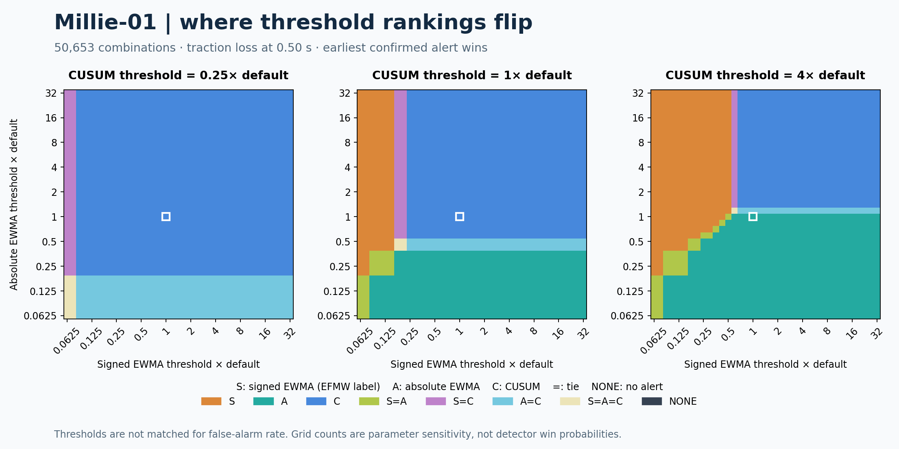

# Millie-01 threshold ranking and flip atlas

**MILLIE-THRESHOLD-001 · Monolithic LLC / Matthew Chenoweth Wright · 16 November 2026**

**All six strict detector orderings occur when thresholds vary independently.** The default ranking is CUSUM → absolute EWMA → signed EWMA. The signed detector can be made first by lowering its threshold; that is threshold sensitivity, not evidence of a distinct EFMW advantage. On the tested common-multiplier diagonal, CUSUM is first or tied whenever any detector alerts.



[Interactive explorer](index.html) · [Full grid: 50,653 rows, CSV gzip](grid-ranking.csv.gz) · [All adjacent ranking changes](adjacent-flips.csv.gz) · [Exact pairwise flip boundaries](pairwise-frontiers.csv) · [Summary JSON](summary.json)

Open `index.html` locally to use the explorer without dependencies or a server. It is also ready to serve from this directory if repository Pages hosting is enabled. This publication does not change hosting settings. The white square in each figure marks S and A at their defaults, while C varies by panel.

## Frozen scope and method

- Source: [`bc35015e90a466812c07742d0ad4558e1e4259d6`](https://github.com/enuminous/Millie-01/tree/bc35015e90a466812c07742d0ad4558e1e4259d6).
- Ranked input: the built-in deterministic `traction_loss` scenario, 80 steps × 0.05 s. Traction becomes 25% at 0.50 s. The first nonzero observed residual arrives at 0.55 s.
- Thresholds: defaults multiplied independently by **2^(k/4), k = −16,…,20**. That is 37 levels from 1/16× to 32×, or **37³ = 50,653** combinations.
- Defaults: S = 0.023, A = 0.030, C = 0.120. Ranges: S = 0.0014375–0.736; A = 0.001875–0.960; C = 0.0075–3.840. The different score constructions do not give equal numerical thresholds a common operating meaning.
- Fixed: signed decay 0.97, absolute decay 0.90, CUSUM allowance 0.005, three consecutive samples strictly above threshold. No dynamics, thresholds in the production defaults, or control rules were changed.
- Ranking: first confirmed alert, earlier first. Reported delays subtract the 0.50 s injection time. Ties keep equal timestamps. **ND** means no alert through the final observation at 3.95 s; it is right-censored, not assigned a fictional time or a detection tie. The last physics step ends at 4.00 s.
- Controls: the other nine built-in scenarios. No pre-injection alerts or alerts in those controls occurred at any tested setting. These noiseless controls cannot estimate realistic false-alarm rates.

The [protocol](protocol.json) was written and hashed before this grid was computed, but after the prior default run was observed. It is an **exploratory sensitivity specification**, not preregistration, independent custody, or the proposed MON-M01 confirmatory experiment. Protocol SHA-256: `ec0794becf67af90f1583b42dc859e4359bec9de2ae28be9ebc0905ea85e9b38`.

## Ranking across the whole grid

S = signed EWMA carrying the EFMW label; A = absolute EWMA; C = two-sided CUSUM. `=` means a genuine same-timestamp detection tie. NONE means all three are undetected within the horizon.

| First detector(s) | Grid cells |
|---|---:|
| A | 12,095 |
| A=C | 3,724 |
| C | 24,540 |
| NONE | 272 |
| S | 7,478 |
| S=A | 853 |
| S=A=C | 248 |
| S=C | 1,443 |

**Counts depend on the arbitrary grid range and spacing. They are not detector win probabilities.** The broad range includes 16 signed, 17 absolute, and one CUSUM threshold levels with no detection. Every combination, including censored cases, is retained in the full grid CSV. The winner grid does not show second and third place; use the full CSV or the explorer's cell inspector for the complete ordering.

Of 147,852 adjacent grid edges, **11,533 change the complete ranking or censoring**, **5,911 change the winner set**, and **563 directly exchange two different sole winners**. Other winner transitions pass through ties or enter/leave a no-alert region. The edge file names the changed threshold, both neighboring cell IDs, both rankings, and the type of change.

## Examples of every strict order

These are post-hoc illustrative cells selected by minimum total absolute quarter-octave distance from defaults, with the loop order breaking equal-distance choices. They are not recommended operating thresholds. `>` means earlier detection.

| Order | S multiplier | A multiplier | C multiplier | Delays S / A / C, seconds |
|---|---:|---:|---:|---|
| A > C > S | 1 | 0.353553 | 1 | 0.90 / 0.20 / 0.25 |
| A > S > C | 0.5 | 0.840896 | 3.36359 | 0.45 / 0.40 / 0.50 |
| C > A > S | 1 | 1 | 1 | 0.90 / 0.45 / 0.25 |
| C > S > A | 1 | 1.68179 | 1 | 0.90 / 1.00 / 0.25 |
| S > A > C | 0.420448 | 1 | 3.36359 | 0.40 / 0.45 / 0.50 |
| S > C > A | 0.148651 | 1 | 1 | 0.20 / 0.45 / 0.25 |

For example, with A and C unchanged, reducing S to **0.003418970455632823** (0.1486508894× default) gives S → C → A, with delays **0.20 / 0.25 / 0.45 s** in that order. With S and C unchanged, reducing A to **0.010606601717798213** gives A → C → S.

When all three thresholds use the **same multiplier**, there are 29 C-only wins, five A=C ties, two S=A=C ties, and one all-ND setting. Neither EWMA is the sole winner on this tested diagonal. The [37-row diagonal table](common-multiplier.csv) preserves every result.

## Exact places where it flips

With C fixed at its default threshold 0.120 (first alert 0.75 s):

| Varied threshold | Faster than C | Ties C | Later than C or ND |
|---|---|---|---|
| Signed EWMA S | below ≈0.003546 | ≈[0.003546, 0.00523962) | at/above ≈0.00523962 |
| Absolute EWMA A | below ≈0.0114 | ≈[0.0114, 0.01626) | at/above ≈0.01626 |

With A fixed at 0.030 (first alert 0.95 s), C is faster below ≈0.330, ties over ≈[0.330, 0.385), and is later or ND at/above ≈0.385. With S fixed at 0.023 (first alert 1.40 s), C is faster below ≈0.825, ties over ≈[0.825, 0.880), then is later or ND.

These displayed numbers are rounded. **Use the stored binary-float values in [pairwise-frontiers.csv](pairwise-frontiers.csv) for equality decisions.** Its 222 rows cover every ordered detector pair and all 37 fixed thresholds. [threshold-bands.csv](threshold-bands.csv) gives all continuous positive threshold bands, with inclusive lower and exclusive upper endpoints, rather than only sampled grid points.

For any score sequence q and a three-sample confirmation rule, let W_j be the running maximum, through sample j, of the minimum score in each completed three-sample window. Detection by j occurs exactly when h < W_j. Against a fixed detector that first alerts at j, the varied detector is faster for h < W_(j−1), tied for W_(j−1) ≤ h < W_j, and later or undetected for h ≥ W_j. This derivation also handles nonmonotonic scores; the test suite checks that case.

## Checks and reproducibility

The score trajectories are independent of the thresholds, and diagnostic alerts do not affect control. Therefore the full Cartesian grid factors exactly into three 37-entry timing vectors. This optimization was checked against **1,110 direct production simulations** (10 scenarios × three monitors × 37 thresholds) plus **nine combined-threshold runs** (eight corners and defaults). All sampled alert flags matched, and position and released wheel outputs were invariant in the single-monitor sweeps.

The 240 traction score samples also match the independent analytic step responses: S_n = 0.06(1 − 0.97^n), A_n = 0.06(1 − 0.90^n), C_n = 0.055n, with n = 1 at 0.55 s. **20 existing tests and four threshold-semantics tests passed.** The JavaScript explorer's rankings match the Python CSV at every one of the 50,653 cells; its four preset handlers passed. Browser rendering could not be validated because browser launch was blocked by this environment; no browser or mobile layout pass is claimed.

```bash
# Run from a clone containing this published study and the frozen Git object.
python research/threshold-sweep-2026-11-16/run_sweep.py
python -m unittest discover -s research/threshold-sweep-2026-11-16 -p 'test_sweep.py' -v
python -m unittest discover -s tests -v
# Optional figures; requires matplotlib:
python research/threshold-sweep-2026-11-16/plot_sweep.py
```

The sweep uses only the Python standard library and extracts the simulator from the pinned Git object into a temporary directory. Later changes to the working-tree simulator cannot silently change these inputs. Source-file SHA-256 values are in `summary.json`. Raw score/control traces are in `source-traces.csv`. `SHA256SUMS.txt` covers the published study files other than itself. Runtime and local test evidence are preserved in the logs and verification JSON.

## Evidence and limits

| Claim | Status |
|---|---|
| Individual threshold changes can reverse the ordering on this trace | **Demonstrated**, all six strict orders retained |
| Common scaling makes signed EWMA the sole winner on this grid | **Rejected** on the tested 37-point diagonal |
| The signed detector is a new mathematical algorithm | **Rejected**: it is the ordinary signed-EWMA recurrence |
| These are matched-false-alarm performance rankings | **Unresolved**; no calibration data or comparable error budgets |
| Results generalize to noise, other fault families, or hardware | **Unresolved** |
| EFMW has a unique practical advantage | **Unresolved**; this sweep supplies no such evidence |

The grid was analyzed by the same assistant workflow that ran the demo; code checks are not independent replication. Examples were chosen after the sweep and labeled accordingly. The finite horizon, noiseless plant, illustrative baseline thresholds and log-spaced grid all affect the visible rankings.

The next discriminating experiment is to freeze a separate noisy calibration corpus and held-out test corpus, calibrate every detector to the same whole-run false-alarm budget, then compare detection delay with misses explicitly penalized across mean-shift, variance, intermittent and oscillatory faults. A distinct EFMW contribution would need to outperform an identically configured signed-EWMA comparator; this implementation is algorithmically identical to that comparator and must tie on identical inputs.
